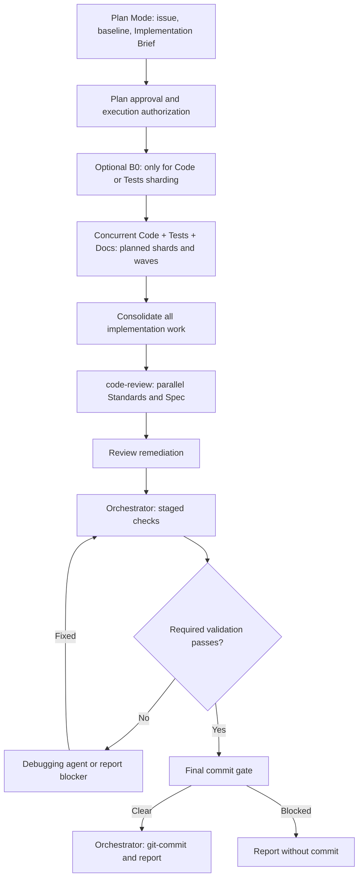

# GitHub Issue Workflow

Implement any GitHub issue through approved planning, parallel implementation, independent review, deferred validation, and a local Conventional Commit.

## Install and invoke

Copy the complete folder, including `references/`, into:

- **Claude Code:** `.claude/skills/github-issue-workflow/`
- **Codex:** `.agents/skills/github-issue-workflow/`

Start the host in **Plan Mode**, then invoke using its supported mechanism:

```text
# Claude Code
/github-issue-workflow https://github.com/OWNER/REPO/issues/123

# Codex
$github-issue-workflow https://github.com/OWNER/REPO/issues/123
```

Alternatively, select the skill in the host UI and pass the issue URL. Invocation and approval mechanisms depend on the host.

## Dependencies

- GitHub issue access through an integration, authenticated `gh`, or repository-supported means.
- Clean-context subagents supporting the three concurrent implementation roles, dependency waves, and nested parallel review agents.
- Installed, invocable Matt Pocock `code-review` and `git-commit` skills.
- Runtime model/effort controls where available; unsupported preferences use disclosed fallbacks/defaults.

## Workflow



## Authoritative instructions

- [SKILL.md](SKILL.md): operating contract, planning brief, and phase order.
- [Agent contracts](references/agent-contracts.md): responsibilities, handoffs, complexity/model profiles, sharding, and B0.
- [Validation](references/validation.md): review, remediation, checks, commit gates, and reporting.

Push and PR creation require an explicit request.
